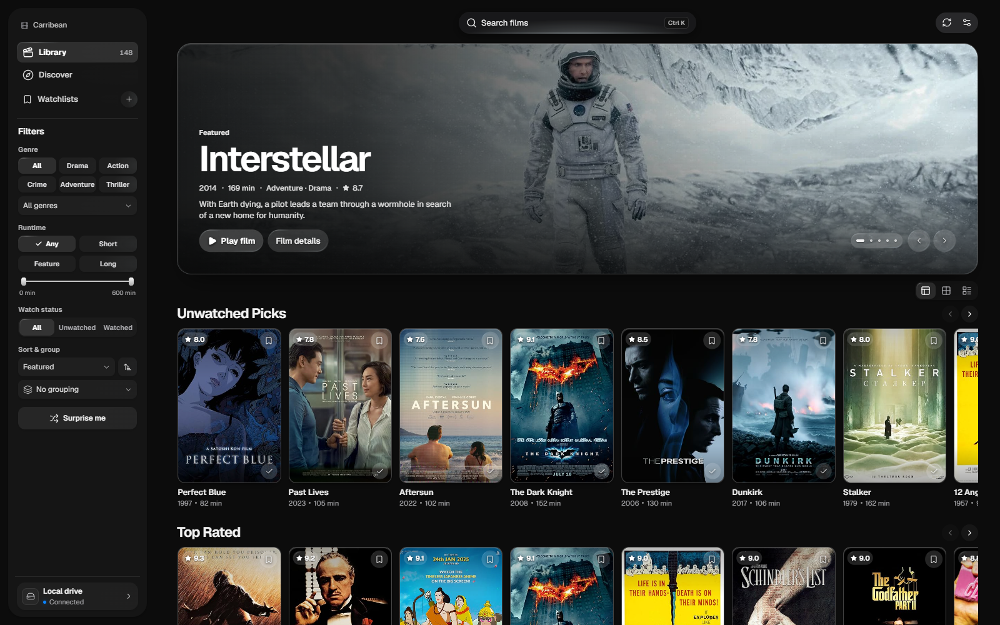
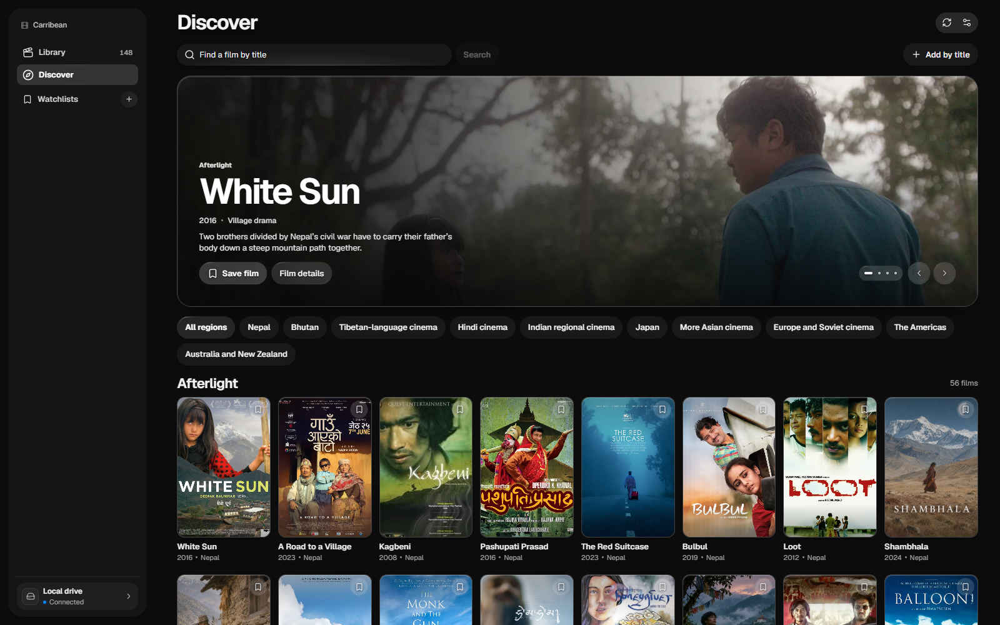
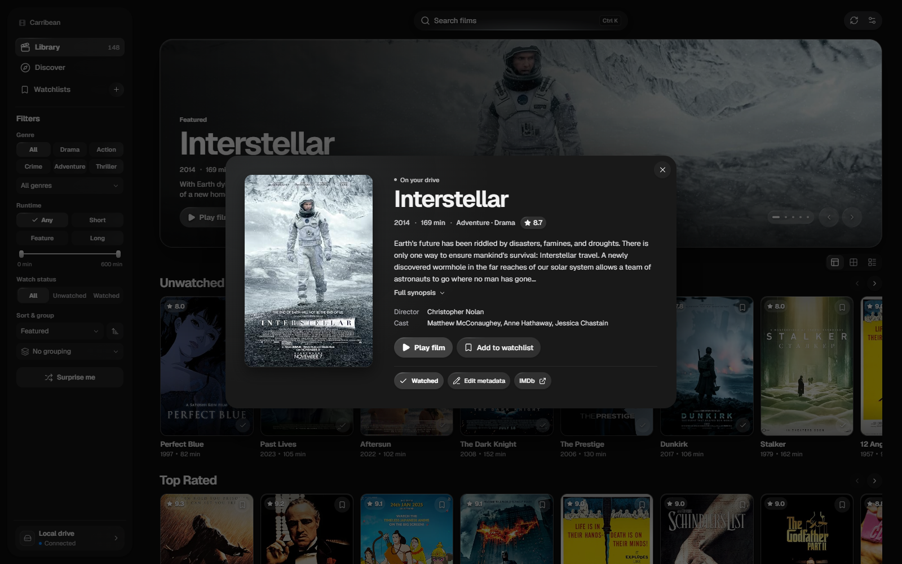

# Carribean

Carribean is a Windows app for organizing the films stored on your hard drive. It brings your local collection, watchlists, discovery, and cross-device Git backup into one fast, poster-led library.

[Download Carribean for Windows](https://github.com/aryanxxvii/carribean-desktop/releases/latest/download/Carribean-Setup-1.0.0.exe) · [Browse all releases](https://github.com/aryanxxvii/carribean-desktop/releases)

> The Windows installer is currently unsigned. Windows may show a SmartScreen warning on first launch. Check that the publisher is unknown, then choose **More info → Run anyway** to continue.

## Screenshots

### Your library

Filter by genre, runtime, and watch status. Sort and group the collection, browse shelves such as Unwatched Picks and Top Rated, and open film details or play a local file.



### Discover films

Search by title, explore curated regional collections, and save discoveries to a watchlist.



### Film details

View the poster, synopsis, cast, and metadata, then play the movie, save it, mark it watched, or edit its details.



## Install on Windows

1. Download **Carribean-Setup-1.0.0.exe** from the [latest release](https://github.com/aryanxxvii/carribean-desktop/releases/latest).
2. Open the downloaded installer. Choose an install folder if you want to change the default, then finish setup.
3. Launch **Carribean** from the Start menu or its desktop shortcut.
4. Open **Settings → Library → Browse**, choose the folder containing your movies, and save. Carribean scans that folder and its subfolders.

Your video files stay where they are. Carribean stores its catalog and settings in your Windows user profile, so uninstalling the app does not remove your movie files.

### Import an existing Carribean library

On first launch, Carribean looks for data from the previous desktop app. You can also open **Settings → Library → Import from the original app** and choose its `backend` or `theatre-data` folder. Export and import of a JSON library snapshot are available in the same settings area.

## Back up and sync between laptops

Carribean can save your library snapshot to a private Git repository. The snapshot includes film metadata, watched status, and watchlists. It does not include video files, local drive paths, or Git credentials.

### Set up Git sync

1. Install [Git for Windows](https://git-scm.com/download/win), including Git Credential Manager.
2. Create a private GitHub repository for the backup, or choose another Git remote that accepts HTTPS.
3. In Carribean, open **Settings → Git sync** and enter the repository HTTPS URL, your Git author name and email, and the backup branch. The default branch name is `carribean-library`.
4. Choose **Sign in to Git** and finish authentication in Git Credential Manager.
5. Choose **Sync now**. Enable **Sync with Git on startup** to sync automatically when Carribean launches. The toolbar sync control refreshes your movie folder and syncs the configured backup.

### Restore on another laptop

Install Carribean, enter the same repository URL and branch in **Settings → Git sync**, sign in, and sync. Then choose that laptop’s movie folder in **Settings → Library**. The library metadata and watchlists come from Git; the new laptop’s local movie paths are scanned separately.

## What Carribean includes

- A local movie catalog with automatic scans, removable-drive status, and playback in your default Windows video player.
- Poster shelves, poster-grid and list views, film search, genre/runtime/watch-status filters, sorting, and grouping.
- Watchlists, watched history, film details, and metadata editing.
- A Discover view with curated recommendations and title lookup.
- Git backup and restore across devices, plus JSON export and import.

## Run from source

Requirements: Windows, Node.js, and npm.

```powershell
git clone https://github.com/aryanxxvii/carribean-desktop.git
cd carribean-desktop
npm ci
npm run dev
```

Open the localhost URL printed by Vite (the default is `http://127.0.0.1:4317/`). Source changes reload in the browser. To run the Electron desktop shell, use `npm run desktop`. To build a Windows installer, use `npm run dist:win`. Run the test suite with `npm test`.

## Credits

Carribean’s original library data and poster cache come from the [original Carribean project](https://github.com/aryanxxvii/carribean). Its recommendation catalog and posters come from [Afterlight](https://afterlight-watchlist.aryanwdn.chatgpt.site/). Spotlight artwork sources are listed below.

[Arrival](https://www.moma.org/calendar/events/2555) · [White Sun](https://trigon-film.org/en/films/white-sun/) · [A Road to a Village](https://www.biff.kr/eng/html/archive/arc_history_view.asp?kind=history&m_idx=68649&pyear=2023) · [Kagbeni](https://www.thefilmnepal.com/movie/kagbeni) · [Pashupati Prasad](https://www.youtube.com/watch?v=CIMUupnpo5Y)

The bundled [Geist](https://vercel.com/font) webfont is available under the SIL Open Font License in `public/fonts/Geist-OFL.txt`.
